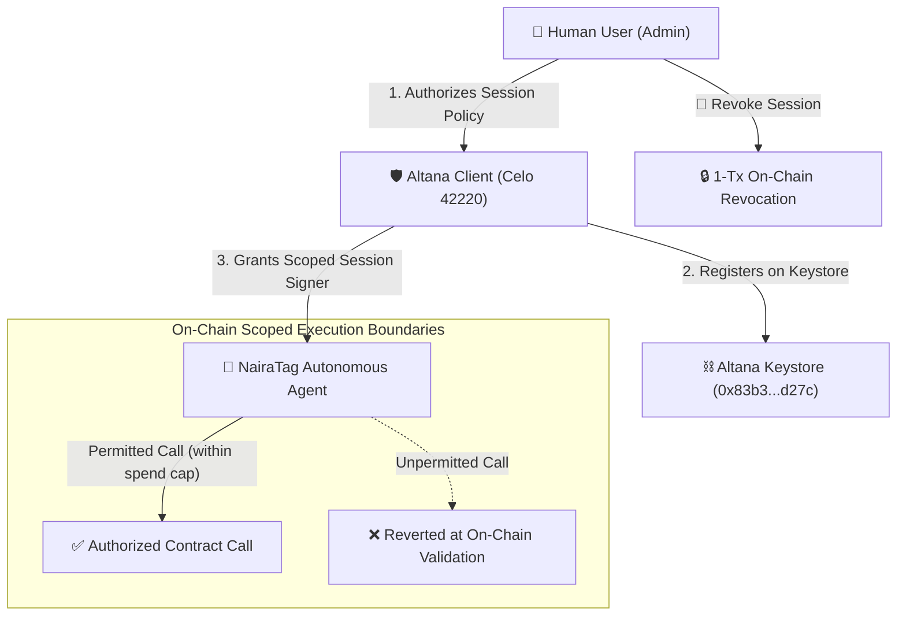

# Altana Agent Wallets: Integration Guide
## NairaTag Agent Commerce on Celo Mainnet (`Chain ID 42220`)

> Track 4 Submission: **Altana Agent Wallets**  
> Hackathon: *Agents Open for Business* (Loops House)

---

## 1. Architectural Overview

NairaTag integrates Altana (`@altananetwork/sdk` v1.1.0) to deliver non-custodial smart agentic wallets on **Celo Mainnet (`Chain ID 42220`)**.

The guiding principle of this track is:
> **"Your Tag is Your Agent."**
> A human user delegates tasks to an autonomous agent (e.g. `₦nairatag`) under hard, cryptographic boundaries: contract allowlists, function selector restrictions, token spend caps, and absolute expiration times—all enforced on-chain and revocable in a single transaction.



---

## 2. On-Chain Contracts & SDK Configuration

Inspected directly from `@altananetwork/sdk` v1.1.0:

| Component | Network | Value | Description |
|---|---|---|---|
| **Execution Network** | Celo Mainnet | `Chain ID: 42220` | Native sub-second settlement (< 1,000ms) |
| **Altana KeyStore** | Celo Mainnet | `0x83b30935f36d6ccf9B1ec3b5E47F2866b97cd27c` | Global on-chain registry of authorized session keys |
| **KeyStore Controller** | Celo Mainnet | `0x47bA5fc2A5b0CcB24BA3fAC9D4B59400eE9fd1D6` | Multi-chain keystore controller |
| **Public RPC** | Celo Mainnet | `https://celo-rpc.publicnode.com` | Primary JSON-RPC endpoint |
| **Altana Relay** | Global | `https://relay.altana.network` | EIP-5792 / EIP-7702 transaction bundler and gas relay |
| **ERC-8004 Registry** | Celo Mainnet | `0x8004A169FB4a3325136EB29fA0ceB6D2e539a432` | Standard Agent Identity Registry (Token #10078) |
| **Hackathon Attribution** | Celo Mainnet | `celo_9f7deabd99a6` | ERC-8021 trailer appended to contract calls |

---

## 3. Administrator vs Agent Session Signers

### 1. Root Administrator Signer
- The human user holds the root administrator signer.
- Supported Signers:
  - **Passkey / WebAuthn Signer** (`createPasskeyWallet({ name })`): Uses biometric Touch ID / Face ID inside the user's secure enclave.
  - **ECDSA Signer** (`signerFromPrivateKey`): Standard secp256k1 keypair.
- **Injected Wallets (MetaMask / Rabby)**:
  Extension wallets act as funding sources (providing CELO, USD₮, or cNGN) to the smart wallet address, while the Altana wallet executes autonomous tasks.

### 2. Scoped Agent Session Signer
- Generated via `createPrivateKeySigner()`.
- The agent process receives **only** this session signer.
- The administrator's private key is **never** shared with the agent, transmitted over the wire, or stored in browser state.

---

## 4. Policy Builder: Contract & Method-Signature Permissions

Altana permissions are enforced on-chain by the smart account validator:

### 1. Function-Level Restrictions (`CallPermission`)
```typescript
{
  calls: [
    {
      to: "0xa9AA0a64769cBed4d3B1Ceb4Df01CdE915C235b3",
      signature: "executeBatch(bytes)"
    }
  ]
}
```
* **Strict Rule**: NairaTag uses `{ to, signature }` wherever possible, ensuring that an allowlisted contract cannot be called with arbitrary, unintended methods. Unrestricted sessions (`calls: []` or wildcard targets) are strictly forbidden.

### 2. Token Spend Limits (`SpendPermission`)
```typescript
{
  spend: [
    {
      limit: 5000000n, // 5.00 USD₮ in 6 decimals
      period: "day",
      token: "0x48065fbBE25f71C9282ddf5e1cD6D6A887483D5e"
    },
    {
      limit: 500000000000000000n, // 0.5 CELO in 18 decimals
      period: "week"
      // token omitted for native CELO
    }
  ]
}
```
* Spend limits are denominated in raw atomic units matching token decimals (6 for USD₮ and cNGN; 18 for CELO).
* Periods supported: `"minute"`, `"hour"`, `"day"`, `"week"`, `"month"`, `"year"`.

### 3. Expiration
- Enforced on-chain using absolute unix epoch seconds (`expiry: number`).

---

## 5. Session Grant, Execution & Revocation Flow

### Step 1: Human Grants Scoped Session
```javascript
const { session, keyId, status } = await grantAgentSession({
  wallet,
  adminSigner,
  policy: buildSessionPolicy({
    allowedContracts: [{ to: targetContract, signature: "submitTask(bytes32,string)" }],
    spendLimits: [{ amount: "2.0", period: "day", token: CELO_USDT_ADDRESS }],
    expiryDurationSeconds: 86400,
  }),
  chainId: 42220,
});
```

### Step 2: Agent Executes Action Autonomously
```javascript
const result = await executeAgentAction({
  session,
  targetContract,
  calldata,
  value: 0n,
  chainId: 42220,
});
```
* Pre-flight checks verify that target contract, method selector, and spend limits conform to policy.
* If calldata is present, the ERC-8021 suffix (`celo_9f7deabd99a6`) is appended.

### Step 3: Human Revokes Session (Immediate Monotonic Cut)
```javascript
const revokeResult = await revokeAgentSession({
  wallet,
  adminSigner,
  sessionOrPublicKey: session,
  chainId: 42220,
});
```
* Revocation executes in a single transaction across Celo.
* Inspects every on-chain leg (`account`, `registry`, `cache`).
* Status returns `"revoked"` only when all legs confirm. Subsequent calls by the agent immediately revert on-chain.
