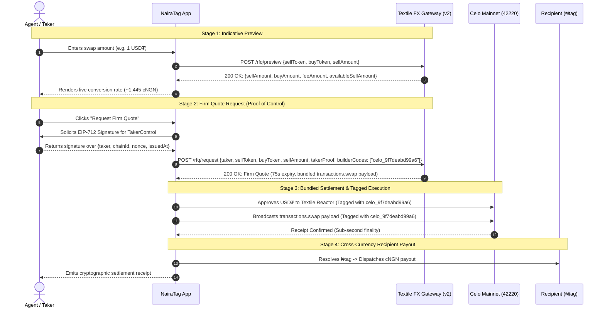

# Textile FX Integration: Stablecoin Corridors (USD₮ ⇄ cNGN)
## NairaTag on Celo Mainnet (`Chain ID 42220`)

> Track 1 Submission: **Stablecoin Corridors (Textile FX)**  
> Agents Open for Business Hackathon ($5,000 Prize Pool)

---

## 1. Executive Summary

NairaTag on Celo integrates Textile FX v2 to deliver high-velocity, low-slippage cross-currency settlement between global dollar liquidity (**USD₮**) and local Nigerian financial rails (**cNGN**). 

By marrying sovereign naming (`₦tag`) with Textile's Request-for-Quote (RFQ) protocol, an autonomous agent or consumer can fund an operation in USD₮ and automatically settle native cNGN to any recipient's `₦tag` in sub-second block finality (< 1,000ms) with zero gas token friction.

Every transaction cryptographically enforces the hackathon entry attribution (`celo_9f7deabd99a6`) per the ERC-8021 specification.

---

## 2. On-Chain Contracts & Architecture

| Component | Network | Address | Description |
|---|---|---|---|
| **Textile LimitOrderReactor** | Celo Mainnet | `0xa9AA0a64769cBed4d3B1Ceb4Df01CdE915C235b3` | Settles bundled limit orders and multi-maker swaps |
| **Permit2** | Celo Mainnet | `0x000000000022D473030F116dDEE9F6B43aC78BA3` | Token approval and permit signature manager |
| **USD₮ (Tether USD)** | Celo Mainnet | `0x48065fbBE25f71C9282ddf5e1cD6D6A887483D5e` | 6 decimals |
| **cNGN (Celo Naira)** | Celo Mainnet | `0xF6829D7393dAe24509eb1E52eE8e572e2E271a4f` | 6 decimals |
| **NairaTag Registry** | Celo Mainnet | `0x19a0C3B78c2e9976378A69d67184b23d9aB0aB1a` | Canonical tag-to-node registry |
| **NairaTag Resolver** | Celo Mainnet | `0xC519729Bf6D15E5984702bba2C553F1c74A73c95` | Multi-asset address and metadata resolver |
| **ERC-8004 Identity Registry** | Celo Mainnet | `0x8004A169FB4a3325136EB29fA0ceB6D2e539a432` | Agent Identity Registry (Token #10078) |

---

## 3. Protocol Flow & RFQ Lifecycle

The integration follows a strict two-stage pricing pipeline matching Textile's OpenAPI 3.1.0 specifications (`https://api.textilecredit.com/v2`):



---

## 4. Textile FX v2 API Endpoints Used

### 1. Indicative Preview: `POST /rfq/preview`
- **Purpose**: Live conversion estimation without requiring on-chain balances or wallet signatures.
- **Request Body**:
  ```json
  {
    "chainId": 42220,
    "sellToken": "0x48065fbBE25f71C9282ddf5e1cD6D6A887483D5e",
    "buyToken": "0xF6829D7393dAe24509eb1E52eE8e572e2E271a4f",
    "sellAmount": "1000000"
  }
  ```
- **Response**:
  ```json
  {
    "status": "preview",
    "sellAmount": "1000000",
    "buyAmount": "1445467557",
    "feeAmount": "0",
    "takerPays": "1000000",
    "effectiveRate": 1445.47,
    "routing": "LIMIT_ORDER_REACTOR"
  }
  ```

### 2. Firm Quote: `POST /rfq/request`
- **Purpose**: Binds real maker liquidity for 75 seconds. Requires EIP-712 proof of control.
- **TakerControl Schema**:
  ```solidity
  struct TakerControl {
      address taker;
      uint256 chainId;
      bytes32 nonce;
      uint256 issuedAt;
  }
  ```
- **Builder Attribution Payload**:
  ```json
  {
    "includeAttribution": true,
    "builderCodes": ["celo_9f7deabd99a6"]
  }
  ```

---

## 5. Multi-Maker Bundled Execution

Textile FX bundles multiple maker fills into a single atomic transaction returned in `transactions.swap`.
NairaTag **never parses only the first order**; it executes the full `transactions.swap` payload:
1. Target reactor: `0xa9AA0a64769cBed4d3B1Ceb4Df01CdE915C235b3`
2. Value: Native CELO value (typically 0 for ERC-20 swaps)
3. Data: Encoded `executeBatch` or `execute` payload carrying the maker signatures, appended with ERC-8021 tag.

---

## 6. Verifiable Cross-Currency Settlement Receipt

Upon execution, the protocol produces an immutable settlement receipt:
```json
{
  "receiptId": "rec_0x5dea3fcc2e575a...",
  "status": "completed",
  "quoteId": "rfq_673e4b...",
  "sourceToken": "USD₮",
  "sourceAmount": "1.000000",
  "swappedToken": "cNGN",
  "swappedAmount": "1445.467557",
  "recipientTag": "₦chowdeck",
  "recipientAddress": "0x71C...b1D",
  "payoutTxHash": "0x...",
  "attributionTag": "celo_9f7deabd99a6",
  "attributionSuffix": "0x63656c6f5f396637646561626439396136110080218021802180218021802180218021",
  "timestamp": 1732179800000
}
```
