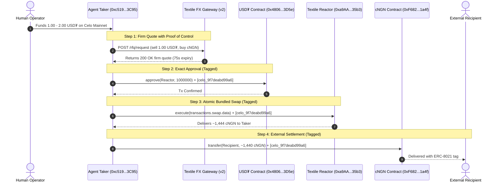

# Track 1 — Mainnet Transaction Readiness (Preflight Only)
## Stablecoin Corridors: Textile FX (USD₮ ⇄ cNGN) on Celo Mainnet (`Chain ID 42220`)

> **Strict Boundary**: Preflight inspection only. Zero Mainnet funds moved, zero contracts deployed, zero approvals broadcasted.

---

## 1. Taker Identity & Wallet Readiness

| Parameter | Specification | Live On-Chain Value |
|---|---|---|
| **Role** | Textile RFQ Taker & Settlement Agent | Official Agent Identity Wallet |
| **Address** | `0xc519729BF6D15e5984702BBa2C553f1c74A73C95` | Checksummed EVM Address |
| **ERC-8004 Identity** | Token ID `10078` on `0x8004A169...a432` | Verified on Celo Mainnet |
| **Nonce** | `1` (1 lifetime transaction sent) | Verified via `forno.celo.org` |
| **Native CELO Gas Balance** | Required: $\ge 0.05\text{ CELO}$ | **18.174017 CELO** (Over $1,000\times$ gas needed) |
| **USD₮ Available Balance** | Required: $\ge 1.00\text{ USD₮}$ | **0.000000 USD₮** (Funding Required) |
| **cNGN Available Balance** | Expected initial: $0.00\text{ cNGN}$ | **0.000000 cNGN** |
| **Current Allowance to Textile** | Spender: `0xa9AA0a64...35b3` | **0.000000 USD₮** |

---

## 2. Funding & Gas Requirements for Minimum Viable Conversion

- **Minimum Viable Conversion Amount**: **`1.00 USD₮`** (Tested on Textile live gateway; yields $\approx 1,444.07\text{ cNGN}$).
- **Recommended Funding Amount**: **`1.50 USD₮`** to **`2.00 USD₮`** (Provides a small buffer for slippage and fee deduction without exposing capital).
- **CELO Gas Reserve**:
  - ERC-20 `approve(0xa9AA...35b3, 1000000)`: $\approx 45,000\text{ gas}$
  - Textile `transactions.swap` (LimitOrderReactor): $\approx 220,000\text{ gas}$
  - ERC-20 `transfer(recipient, 1440000000)`: $\approx 55,000\text{ gas}$
  - Total Estimated Gas: $\approx 320,000\text{ gas units}$ ($\approx 0.016\text{ CELO}$ at 50 gwei).
  - Current Gas Balance: **18.174 CELO** is fully sufficient. **Zero additional CELO gas funding is needed.**

---

## 3. External Recipient & Payment Flow

1. **Anti-Collusion / Independence Requirement**:
   - The recipient must **not** be any team-controlled wallet:
     - $\times$ Not `0xc519729BF6D15e5984702BBa2C553f1c74A73C95` (Agent taker)
     - $\times$ Not `0x7c26a1F03339E2Ea74D261D97f5ab9C38181AF26` (Bloom team)
     - $\times$ Not `0x653f773C9062e71A6554b42a9525fcD47fCC1693` (NairaTag orchestrator)
   - External Recipient Target: An external third-party address or independent tester wallet specified by the human operator.
2. **Resolution & Delivery**:
   - Recipient can be provided either as an external EVM address (`0x...`) or as a registered external `₦tag`.
   - Resulting cNGN ($\approx 1,440\text{ cNGN}$) is transferred directly to this external recipient with the ERC-8021 attribution suffix appended.

---

## 4. Firm RFQ Readiness & Gateway Protocol

1. **Proof of Control (`TakerControl`)**:
   - Domain: `{ name: 'Textile Taker Control', version: '1', chainId: 42220 }`
   - Struct: `{ taker, chainId, nonce, issuedAt }`
   - Entropy: 32 random bytes generated via `crypto.getRandomValues`.
2. **Live Gateway Behavior**:
   - With 0 USD₮ balance: Gateway responds `400 invalid_request: insufficient_funds`, verifying that signature parsing and on-chain balance verification are functioning.
   - With $\ge 1.00\text{ USD₮}$ balance: Gateway will issue a firm quote with 75-second expiration and multi-maker `transactions.swap` calldata.

---

## 5. Calldata & ERC-8021 Attribution Verification

### Attribution Suffix (35 bytes)
`0x63656c6f5f396637646561626439396136110080218021802180218021802180218021`

### Exact Calldata Composition:
- **Tx 1: USD₮ Approval**:
  - Target: `0x48065fbBE25f71C9282ddf5e1cD6D6A887483D5e` (USD₮)
  - Function: `approve(0xa9AA0a64769cBed4d3B1Ceb4Df01CdE915C235b3, 1000000)`
  - Encoded: `0x095ea7b3000000000000000000000000a9aa0a64769cbed4d3b1ceb4df01cde915c235b300000000000000000000000000000000000000000000000000000000000f4240`
  - Tagged: Encoded + `CELO_ATTRIBUTION_SUFFIX`
- **Tx 2: Textile Swap Execution**:
  - Target: `0xa9AA0a64769cBed4d3B1Ceb4Df01CdE915C235b3` (LimitOrderReactor)
  - Data: `transactions.swap.data` + `CELO_ATTRIBUTION_SUFFIX`
  - Value: `0`
- **Tx 3: Recipient cNGN Payout**:
  - Target: `0xF6829D7393dAe24509eb1E52eE8e572e2E271a4f` (cNGN)
  - Function: `transfer(recipientAddress, amountCngnAtomic)`
  - Tagged: Encoded + `CELO_ATTRIBUTION_SUFFIX`

---

## 6. Execution Safeguards & Anti-Replay

1. **Idempotency Guard**:
   Each payout assigns an immutable `intentId = keccak256(recipient:amount:timestamp)`. Persisted in client state to prevent duplicate submissions.
2. **Quote Lapsing Guard**:
   If quote lifetime exceeds 75 seconds or if the approval confirmation takes $> 70\text{ seconds}$, swap execution is immediately halted, preventing execution of lapsed maker pricing.
3. **Exact Allowance Safety**:
   Approval is strictly restricted to `1000000` (1 USD₮). No infinite approval is ever requested.

---

## 7. Transaction-by-Transaction Sequence

---

## 8. Remaining Risks & Mitigations

1. **Maker Liquidity Window**:
   - Risk: 75-second quote expires if approval confirmation is delayed.
   - Mitigation: Celo block time is $\approx 1\text{ second}$. Approval confirms in $< 2\text{ seconds}$, leaving $> 70\text{ seconds}$ for the swap execution.
2. **Attribution Indexing Lag**:
   - Risk: Loops House indexer may take several minutes to reflect the attributed transaction.
   - Mitigation: Record the exact block number and transaction hash directly from CeloScan to provide direct verifiable proof.
